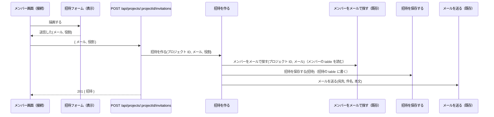
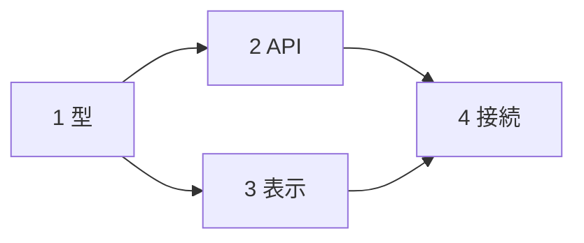

# tk-stack-interface-first-development

複数フェーズに分かれる大規模な実装で、root session はインターフェースだけを設計書に定義し、実装を user が開く別 session（子）に引き継ぐ。root はコードを書かず、関数の中身や DB のクエリも考えない。その分を、子が設計書だけを読んで迷わず作れること、並列に進む子どうしがつなぎ目で食い違わないことに使う。設計書は root と子の契約で、書き換えるのは root だけにする。

root は repo 本体の checkout（linked worktree ではない）の default branch で起動する。root はコードを書かず commit もしないので、自分の branch は要らない。herdr で委任するとき、子 workspace を root の workspace の下に開けるのも repo 本体の workspace だけ。複数の機能を並列に進めるときは、repo 本体の workspace に tab を足して root を起動し、同じ checkout を共有する（root は branch を切り替えない）。

## 手順

1. **要件を固める** — root が repo 本体の checkout の default branch にいること（`git rev-parse --show-toplevel` が `git worktree list` の 1 行目の path で、`git branch --show-current` が default branch）を確かめ、違えば、そこで起動し直すよう user に伝えて止まる。依頼と既存コードを読み、作る画面・endpoint・扱うデータ、使える既存の関数、ファイル配置の規約をつかむ。調査が広ければ subagent に任せ、root の context は設計に残す。設計が分かれる要件は user に聞き、小さな判断は仮置きして設計書の「未決事項」に書く。完了条件: 画面・endpoint・データの一覧と対象外が決まっている
2. **設計書を書く** — 下の「設計書」のとおり、設計書のディレクトリ（置き場所の規約が無ければ `docs/design/<機能名>/`）に README.md とフェーズごとのファイルを書く。完了条件: 次の整合チェックをすべて満たす
   - 画面表示・フォーム送信・cron などの操作ごとに、README に流れの図がある
   - 流れの図に出る endpoint・関数・component がすべて関数の木にあり、関数の木の【N】の付いたものがすべてどれかの流れの図に出る
   - ファイルの表の「中身」の名前がすべて関数の木か「型と API」にあり、関数の木の【N】の付いたものはちょうど 1 つのファイルの「中身」にあって、そのファイルのフェーズが N
   - 関数の木の親子で、親のフェーズが子のフェーズより先に始まらない（子が既存か、子のフェーズが親と同じか、親のフェーズの前提に入っている）
3. **規約と今の実装に合わせる** — user に設計書を見せる前に毎回、`tk-stack-skill-review` を使う subagent と `tk-stack-drift-review` を使う subagent に、並行して設計書をレビューさせ、指摘は root が設計書に反映する（subagent には書き換えさせない）。規約から外れた配置や signature、今のコードや文書と食い違う設計のまま引き継ぐと、設計書に合わせる契約の子はそれを直せず、並列の子が同じズレを写す。subagent には設計書のディレクトリの絶対 path と次の読み方を渡す。完了条件: 指摘がすべて「直した」か「直さない（理由付き）」に分かれ、設計書が手順 2 の整合チェックを満たしている
   - skill-review: README のファイルの表の各ファイルを、「中身」に書いた関数・型（signature は関数の木と「型と API」）と画面・API を持つコードとみなして、適用する SKILL を選ぶ
   - skill-review: 関数の本体は子に任せていて設計書に無いので、本体の書き方の規約（使う hook、state の持ち方、validator、クエリの書き方、テストの組み立て）は適用外にする。その種の指摘は設計書に書き足さない。子が担当ファイルを skill-review に通すときに当たる
   - skill-review: 関数・型の名前は日本語で、signature は擬似言語で書いた子との契約なので、命名と実装の言語の書き方の規約（戻り値の型アノテーションを書かない など）の違反にしない。識別子は子が repo の命名規約で決める（ファイルの path には命名の規約を当てる）
   - drift-review: 関数の木の（既存）の行と、ファイルの表の「変更」のファイルを今のコードと突き合わせる。設計どおりに実装すると古くなる文書は、ファイルの表に「変更」で載っていないものだけを指摘にする（載っていれば担当のフェーズが直す）
   - どちらも、user の指摘を反映して繰り返す時は、前回のレビュー以降に変えたファイルと節を対象にする
4. **レビューを受ける** — README の path と、画面・endpoint・フェーズの要約、手順 3 で直した指摘と、直さなかった指摘・要確認・SKILL 同士の食い違い（理由付き）を示して止まる。指摘は設計書に反映し、手順 3 から繰り返して user の承認を得る
5. **引き継ぐ** — フェーズごとに引き継ぎ prompt を出し、並列に始めてよいフェーズの組と順序（例: `1 → 2 と 3 を並列 → 4`）を添える。herdr の中（`HERDR_ENV=1`）なら、続けて `skill://tk-stack-handoff` に従い、root が子を起動して質問に答え、フェーズごとの PR を merge まで進める。それ以外は root の作業はここで終わる

## 設計書

README.md に全体像と、関数・型・API のすべてを書く。フェーズごとのファイル `phase-<N>-<名前>.md` には、そのフェーズのゴール・前提・完了条件と、そのフェーズだけに関わる決まりを書く（`<名前>` は英小文字と `-` の短い名前で、tk-stack-handoff の `<task>` の `p<N>-<名前>` とそろえる）。1 つの事実は 1 か所にだけ書き、ほかからは「README の『流れ: 招待の送信』」のように節の名前で指す。関数・component・型・項目・table の名前は日本語で書き、英語の識別子は書かない（endpoint の path・ファイルの path・status はそのまま書く）。例は「プロジェクトへのメンバー招待」。

なぜ: 1 ファイルにまとめると、user は全体像にたどり着く前に詳細に埋もれ、子は自分に関係しないフェーズまで読む。分けておけば、user はフェーズ単位でレビューでき、子の報告で設計を直すときも root が触るファイルが絞れる。同じ事実を 2 か所に書くと、直したときに片方だけが古くなる。名前を日本語にすると、user は英語の識別子を読み替えずに、何をする関数かで構造を確かめられる。識別子を子が決めても、つなぎ目は合う。呼ぶ側のフェーズは呼ばれる側のフェーズが終わってから始まるので、呼ぶ側の子はコードにある名前を使える。並列のフェーズどうしは呼び合わない。

### 記法

signature と型は実装の言語ではなく、日本語の名前の擬似言語で書き、README の「記法」に次を載せる。

```text
関数       名前(引数, …) → 戻り値。戻り値が無ければ → を書かない
           失敗するときは、次の行に「失敗: 理由, …」
component  名前（表示 または 接続）。次の行に「受け取る: …」「知らせる: 名前(引数)」
形         { 項目, 項目? }。項目? は無いことがある。X[] は X の一覧。A | B はどちらか
型         名前から分からないときだけ「役割: owner | member」のように書く
印         【N】はフェーズ N で作る・変えるもの。（既存）は今あるものを使う
```

```text
Bad: 実装の言語と英語の識別子で書く。export・ジェネリクス・型注釈に、何をする関数かが埋もれる
execute(args: { projectId: string; email: string; role: Role }): Promise<Result<Invitation, AlreadyMemberError | DbError | MailError>>

Good:
招待を作る(プロジェクト ID, メール, 役割) → 招待
  失敗: 既に member, DB, メール送信
```

なぜ: user が確かめたいのは、何をする関数が何を受け取り何を返すかで、構文や識別子ではない。class の method にするか、依存をどう渡すかは、子が repo の規約で決める。

### README.md

次の節を順に並べる。図は Mermaid で描き、flowchart のラベルは `p1["1 型"]` のように引用符で囲む（括弧や記号で図が壊れない）。sequenceDiagram の participant は ASCII の短い id にし、日本語の名前を `as` で付ける。

1. **目的・対象外・未決事項**
2. **全体の図** — 画面・API・外部のサービス（DB・メールなど）のつながりを flowchart で描く
3. **画面** — 画面（route）ごとに、フォームの項目と、機能を「操作 → 呼ぶ API → 成功・失敗で起きること」で書く。見た目はデザインに任せ、あれば URL を書く
4. **流れ** — 操作（画面表示、フォーム送信、cron など）ごとに sequenceDiagram で描く
5. **関数の木** — 起点から、呼ぶ関数・描画する component を tree で書く
6. **型と API** — 関数の木と API に出る形と、endpoint ごとの method・path・認証・request・status ごとの response
7. **ファイルとフェーズ** — フェーズの依存を flowchart で描き、ファイルの表（ファイル・新規 / 変更 / 既存・中身・フェーズ）を置く
8. **記法**

#### 画面

```md
#### /projects/:projectId/members

| 項目   | 入力   | 必須 | 検証           |
| ------ | ------ | ---- | -------------- |
| メール | email  | ✓    | メールの形式   |
| 役割   | select | ✓    | owner / member |

- 送信 → POST /api/projects/:projectId/invitations。201 でフォームを空にし、409 はメール欄の下に「既に member です」と出す
```

なぜ: 操作と API の対応が書いてあれば、UI の子は API の節と突き合わせるだけで実装できる。

#### 流れ

参加者は endpoint・関数・component（既存を含む）だけにし、関数の木と同じ名前を付ける。呼ぶ・描画するは実線（`->>`）、返す・知らせるは点線（`-->>`）で、呼ぶ順に並べ、読み書きする table を矢印の説明に添える。

```text
Bad: 呼ぶ関係が 1 列に潰れ、クエリまで書いている
招待フォーム → POST /api/projects/:projectId/invitations → 招待を作る → メンバーをメールで探す → db.select().from(members) → 招待を保存する → メールを送る
```

Good:



なぜ: 操作ごとの順番と、どの table を読み書きするかは、関数の木からは読めない。知らせる（callback）を実線で描くと、表示（先のフェーズ）が接続（後のフェーズ）を呼ぶように見え、フェーズの前後と食い違う。クエリは repository の中身で、担当の子が行の形を見て書ける。

#### 関数の木

起点（画面の route の component、cron の処理など）を根にして、呼ぶ関数・描画する component を子に、`tree` コマンドの形で書く。兄弟は呼ぶ順に並べ、深くなってもそのままネストする。1 行に 1 つの関数を書き、行の終わりに印を付ける。失敗・受け取る・知らせるは次の行に、木の縦線をそろえて書く。endpoint は、それを呼ぶ接続の子に path で置く。

- ファイルの外から使われる関数・component・hook をすべて載せる。ファイルの中だけで使う補助関数は載せない
- 同じ関数が 2 か所以上に出るときは、2 回目からは名前と印だけにする（signature は最初の 1 回に書く）
- 枝は呼ぶ・描画する向きだけにする。表示 component が知らせる callback は親の接続が受け取るもので、枝にしない
- UI は、受け取るものだけで描く表示 component（Presentational）と、API を呼んで表示 component に渡す接続（Container。route の component や hook）に分ける。表示 component が受け取る形は API の response の形（日付は文字列）に合わせ、接続が response をそのまま渡せるようにする
- 接続は、どの API を呼び、どの表示に渡すかを子の枝で表す。使う hook・state の持ち方・validator・クエリの書き方は書かない（子が repo の規約で決める）

```text
Bad: ファイルごとに関数を並べ、呼ぶ関係は別の節と突き合わせないと分からない。中身の手順や hook を書く
### api/usecase/create-invitation.ts
- execute — members を select して、無ければ insert し、MailClient.send を呼ぶ
### web/routes/members.tsx
- MembersPage — useState で email を持ち、useMutation で POST する

Good:
メンバー画面（接続）【4】
├── 招待フォーム（表示）【3】
│     受け取る: 送信中か, エラー?: 「既に member」
│     知らせる: 送信した(メール, 役割)
└── POST /api/projects/:projectId/invitations【2】
    └── 招待を作る(プロジェクト ID, メール, 役割) → 招待【2】
        │ 失敗: 既に member, DB, メール送信
        ├── メンバーをメールで探す(プロジェクト ID, メール) → メンバー?（既存）
        ├── 招待を保存する(招待) → 招待【2】
        └── メールを送る(宛先, 件名, 本文)（既存）
```

なぜ: 木の親子が、そのまま呼ぶ関係とフェーズの前後になる。子は自分の【N】の行から上をたどれば誰に呼ばれるかが、下をたどれば何を呼ぶかが分かる。木に無い関数は session ごとに別の形で作られ、つなぎ目で合わない。既存の関数を木に載せれば二重実装も防げる。中身を書くと、user が確かめたい構造が手順に埋もれ、誰も動かしていない処理を子が写すことになる。表示 component は API を待たずに作れて、受け取るものを渡すテストで確かめられるので、API と並列のフェーズにできる。

#### 型と API

型は記法の形で、日本語の項目名で書く。新しい table は行の形と、業務ルールに関わる制約（unique など）で書き、ORM の定義コードは子に任せる。

```md
- 役割 = `owner | member`
- 招待 = `{ ID, プロジェクト ID, メール, 役割, 作成日時 }`
- 招待の table（新規）— 行は招待。unique: (プロジェクト ID, メール)

#### POST /api/projects/:projectId/invitations

- 認証: 必須。project の owner だけ
- request: `{ メール, 役割 }`
- response: 201 `{ 招待 }` / 400 入力が不正 / 403 owner ではない / 409 既に member か、未承諾の招待がある
```

なぜ: 同じ型をフェーズごとに定義させると形が少しずつずれ、つなぎ目で合わなくなる。API と UI を別の子が作るとき、両者が共有するのはこの定義だけ。失敗の status が無いと、UI の子はエラー表示を推測で書く。項目の英語の名前（JSON の key・列名）は、型のファイルを持つフェーズの子が決め、後のフェーズはそのコードに合わせる。

#### ファイルとフェーズ



```md
| ファイル                         | 新規・変更 | 中身                         | フェーズ |
| -------------------------------- | ---------- | ---------------------------- | -------- |
| shared/invitation.ts             | 新規       | 役割・招待（型）             | 1        |
| api/routes/index.ts              | 変更       | 招待 API の route を登録する | 2        |
| api/routes/invitations.ts        | 新規       | POST …/invitations           | 2        |
| api/usecase/create-invitation.ts | 新規       | 招待を作る                   | 2        |
| api/repository/invitation.ts     | 新規       | 招待を保存する               | 2        |
| api/repository/member.ts         | 既存       | メンバーをメールで探す       | —        |
| api/client/mail.ts               | 既存       | メールを送る                 | —        |
| web/components/InviteForm.tsx    | 新規       | 招待フォーム                 | 3        |
| web/routes/members.tsx           | 変更       | メンバー画面                 | 4        |
```

「中身」には、そのファイルに置く関数・component・型を、関数の木・「型と API」と同じ名前で書く。関数を置かないファイル（設定・登録・文書）は、何を変えるかを書く。既存のファイルは、使う関数だけを書き、フェーズは「—」にする。

なぜ: 置き場所を子に任せると、session ごとに別の場所・名前で作られる。担当もファイル単位で決めるので、この表が分担の単位になる。名前が日本語なので、関数とファイルを結ぶのもこの表になる。

### phase-<N>-<名前>.md

フェーズごとに次の形で書く。

```md
# フェーズ 2 API

- ゴール: 招待 API が動く
- 前提フェーズ: 1
- 完了条件: use case のテストが通る
- 担当: README のファイルの表でフェーズ 2 の行。関数の signature は関数の木の【2】の行にある
```

そのフェーズだけに関わる決まり（E2E のケース、設定の変え方、一時的に失敗してよい lint など）があれば、続けて箇条書きで書く。関数・型・signature はここに書かない。

なぜ: 子は README で全体と担当をつかみ、このファイルで完了の基準を知る。signature を README だけに置けば、設計を直すときに 1 か所で済み、フェーズのファイルが古くならない。

### フェーズの分け方

1 ファイルは 1 フェーズだけが持つ。前提は関数の木の親子と型の参照で決め、呼ぶ側は呼ばれる側のフェーズが終わってから始める。表示 component は使う型だけを前提に API と並列に作り、接続はその両方が終わってから作る。1 フェーズは 1 session で終わる大きさにし、確かめられる完了条件を付ける。

```text
Bad: 2 つのフェーズが api/routes/index.ts を持ち、UI 全体が API を待って直列になる
1 API — api/routes/invitations.ts, api/routes/index.ts
2 UI  — web/routes/members.tsx, api/routes/index.ts（前提 1）

Good: 1 → 2 と 3 を並列 → 4
1 型   — shared/invitation.ts。完了条件: 型チェックが通る
2 API  — api/routes/index.ts, api/routes/invitations.ts, api/usecase/create-invitation.ts,
         api/repository/invitation.ts（前提 1）。完了条件: use case のテストが通る
3 表示 — web/components/InviteForm.tsx（前提 1）。完了条件: 受け取るものを渡した描画テストが通る
4 接続 — web/routes/members.tsx（前提 2, 3）。完了条件: 型チェックと画面のテストが通る
```

なぜ: 並列の子が同じファイルを触ると、片方の変更が上書きされるか merge で衝突する。呼ぶ先がまだ無いフェーズは型チェックが通らず、完了を確かめられない。大きすぎるフェーズは子の context を使い切り、途中で設計書の前提を落とす。

## 引き継ぎ prompt

フェーズごとに次の形で出す。子は会話の履歴を持たないので、設計書は絶対 path で指す（worktree を分けても同じ設計書を読める）。

```md
<設計書のディレクトリの絶対 path> の README.md と phase-<N>-<名前>.md を読み、フェーズ N を実装してください。

- 作るのは、README のファイルの表でフェーズ N の行のファイルと、その「中身」。関数の signature は README の関数の木の【N】の行にある。触るのはフェーズ N のファイルだけ
- 設計書の名前は日本語で書いてある。識別子は repo の命名規約で決める。前提フェーズで作られたものと既存のものは、コードにある名前をそのまま使う（どのファイルにあるかはファイルの表にある）
- 引数・戻り値・失敗・受け取るもの・知らせるものは設計書に合わせる（README の「記法」で読む。戻り値の型は、導出された型が一致すればよい）。ファイルの中だけで使う補助関数は自由に足してよい
- 設計書のとおりでは実装できない、または担当外のファイルを変える必要が出たら、そこで止めて理由と変更案を報告する
- 完了条件: <フェーズの完了条件>
- 完了条件を満たしたら、報告の前に `tk-stack-skill-review` を使う subagent と `tk-stack-drift-review` を使う subagent に、並行して担当ファイルだけをレビューさせる。drift-review には設計書の path も渡す（ほかのフェーズの担当ファイルはまだ無くてよい）。subagent には直させず、指摘はあなたが直し、直した後も完了条件を満たすことを確かめる。設計書の signature・型・ファイル配置か、担当外のファイルを変えないと直せない指摘は、直さずに報告する
- 最後に、変更したファイル・完了条件の確認結果・skill-review と drift-review で直した指摘と直さなかった指摘（理由付き）・設計書との差分を報告する。commit はしない
```

子に止めて報告させるのは、他の子が同じインターフェースを前提に並列で進んでいるから。設計書から来る規約の指摘を子に直させないのも同じ理由で、直すかどうかは root が設計書で決める。skill-review と drift-review の指示を prompt に書くのは、子がこの SKILL を読まないから。user がその報告を root に持ってきたら（tk-stack-handoff で委任したなら、子から intercom で直接届く）、root が設計書を直して手順 3 を通し、影響するフェーズと出し直す引き継ぎ prompt を示す。
